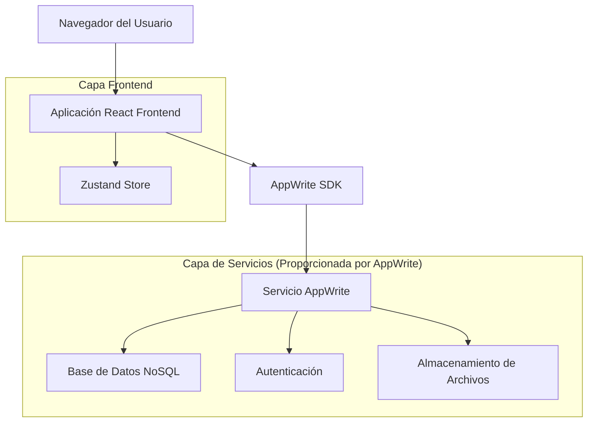
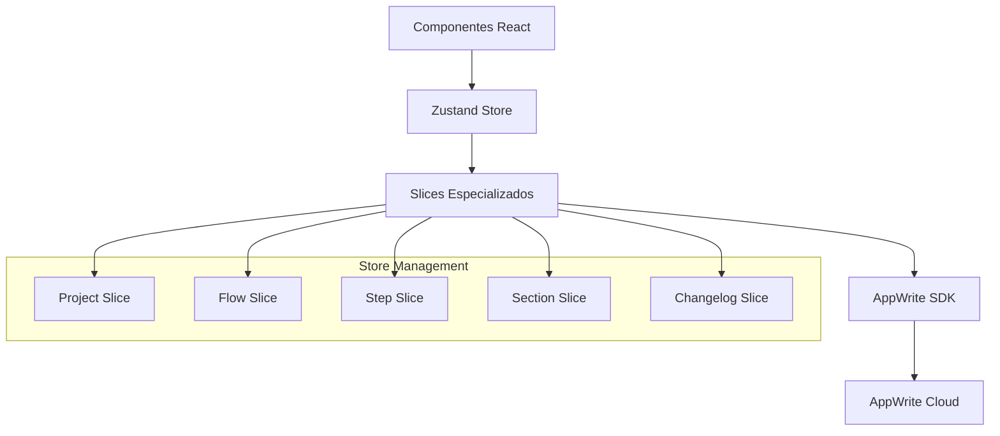
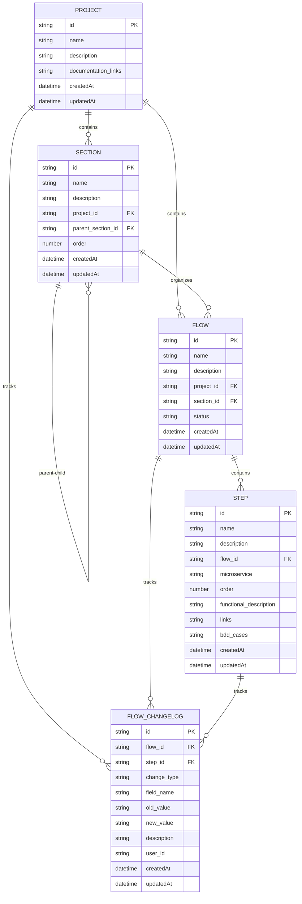

# FlowDocs - Documento de Arquitectura Técnica

## 1. Diseño de Arquitectura



## 2. Descripción de Tecnologías

* **Frontend**: React\@18 + Next.js\@13.5.1 + TypeScript + Tailwind CSS + Zustand

* **Backend**: AppWrite (Backend-as-a-Service)

* **Base de Datos**: AppWrite Database (NoSQL)

* **UI Components**: Radix UI + shadcn/ui

* **Diagramas**: React Flow

* **Drag & Drop**: @dnd-kit

* **Exportación**: jsPDF + html2canvas

## 3. Definiciones de Rutas

| Ruta                            | Propósito                                                       |
| ------------------------------- | --------------------------------------------------------------- |
| /                               | Página de inicio con hero section y características principales |
| /projects                       | Dashboard de proyectos, lista y gestión de proyectos            |
| /projects/\[id]                 | Vista detallada de proyecto con secciones y flujos              |
| /projects/\[id]/flows/\[flowId] | Editor visual de flujos con diagramas interactivos              |

## 4. Definiciones de API (AppWrite Collections)

### 4.1 APIs Principales

**Gestión de Proyectos**

```
GET /databases/{databaseId}/collections/68866b70001252bec5ac/documents
```

Request:

| Parámetro | Tipo   | Requerido | Descripción                        |
| --------- | ------ | --------- | ---------------------------------- |
| queries   | array  | false     | Filtros de consulta AppWrite       |
| limit     | number | false     | Límite de resultados (default: 25) |

Response:

| Campo     | Tipo   | Descripción         |
| --------- | ------ | ------------------- |
| documents | array  | Lista de proyectos  |
| total     | number | Total de documentos |

Ejemplo:

```json
{
  "documents": [
    {
      "$id": "project_123",
      "name": "Sistema de Pagos",
      "description": "Microservicios para procesamiento de pagos",
      "documentation_links": "{\"api\": [{\"url\": \"https://api.docs\", \"title\": \"API Reference\"}]}"
    }
  ],
  "total": 1
}
```

**Gestión de Flujos**

```
POST /databases/{databaseId}/collections/68866bc50026c708b251/documents
```

Request:

| Parámetro   | Tipo   | Requerido | Descripción                                                       |
| ----------- | ------ | --------- | ----------------------------------------------------------------- |
| name        | string | true      | Nombre del flujo                                                  |
| description | string | true      | Descripción del flujo                                             |
| project\_id | string | true      | ID del proyecto padre                                             |
| section\_id | string | false     | ID de la sección (opcional)                                       |
| status      | string | true      | Estado: draft, in-progress, review, approved, completed, archived |

Response:

| Campo      | Tipo   | Descripción               |
| ---------- | ------ | ------------------------- |
| $id        | string | ID único del flujo creado |
| $createdAt | string | Fecha de creación         |

**Gestión de Pasos**

```
PUT /databases/{databaseId}/collections/68866da8002a5a5eeb2a/documents/{stepId}
```

Request:

| Parámetro               | Tipo   | Requerido | Descripción                     |
| ----------------------- | ------ | --------- | ------------------------------- |
| name                    | string | true      | Nombre del paso                 |
| microservice            | string | true      | Microservicio responsable       |
| functional\_description | string | true      | Descripción funcional detallada |
| bdd\_cases              | string | false     | Casos BDD en formato texto      |
| links                   | string | false     | JSON con enlaces relacionados   |
| order                   | number | true      | Orden de ejecución              |

## 5. Arquitectura del Cliente



## 6. Modelo de Datos

### 6.1 Definición del Modelo de Datos



### 6.2 Lenguaje de Definición de Datos (DDL)

**Colección Projects (ID: 68866b70001252bec5ac)**

```javascript
// Estructura de atributos en AppWrite
{
  "name": {
    "type": "string",
    "size": 255,
    "required": true
  },
  "description": {
    "type": "string",
    "size": 1000,
    "required": true
  },
  "documentation_links": {
    "type": "string",
    "size": 5000,
    "required": false,
    "default": "{}"
  }
}

// Índices recomendados
// - name (ascending)
// - $createdAt (descending)
```

**Colección Flows (ID: 68866bc50026c708b251)**

```javascript
{
  "name": {
    "type": "string",
    "size": 255,
    "required": true
  },
  "description": {
    "type": "string",
    "size": 1000,
    "required": true
  },
  "project_id": {
    "type": "string",
    "size": 36,
    "required": true
  },
  "section_id": {
    "type": "string",
    "size": 36,
    "required": false
  },
  "status": {
    "type": "string",
    "size": 20,
    "required": true,
    "default": "draft"
  }
}

// Índices recomendados
// - project_id (ascending)
// - section_id (ascending)
// - status (ascending)
// - $createdAt (descending)
```

**Colección Steps (ID: 68866da8002a5a5eeb2a)**

```javascript
{
  "name": {
    "type": "string",
    "size": 255,
    "required": true
  },
  "description": {
    "type": "string",
    "size": 500,
    "required": true
  },
  "flow_id": {
    "type": "string",
    "size": 36,
    "required": true
  },
  "microservice": {
    "type": "string",
    "size": 100,
    "required": true
  },
  "order": {
    "type": "integer",
    "required": true,
    "default": 0
  },
  "functional_description": {
    "type": "string",
    "size": 2000,
    "required": false
  },
  "links": {
    "type": "string",
    "size": 3000,
    "required": false,
    "default": "[]"
  },
  "bdd_cases": {
    "type": "string",
    "size": 5000,
    "required": false
  }
}

// Índices recomendados
// - flow_id (ascending)
// - order (ascending)
// - microservice (ascending)
```

**Colección Sections (ID: 68866c4c000b18d9e454)**

```javascript
{
  "name": {
    "type": "string",
    "size": 255,
    "required": true
  },
  "description": {
    "type": "string",
    "size": 1000,
    "required": false
  },
  "project_id": {
    "type": "string",
    "size": 36,
    "required": true
  },
  "parent_section_id": {
    "type": "string",
    "size": 36,
    "required": false
  },
  "order": {
    "type": "integer",
    "required": true,
    "default": 0
  }
}

// Índices recomendados
// - project_id (ascending)
// - parent_section_id (ascending)
// - order (ascending)
```

**Colección Flow Changelog (ID: 68870aa100009524946c)**

```javascript
{
  "flow_id": {
    "type": "string",
    "size": 36,
    "required": true
  },
  "step_id": {
    "type": "string",
    "size": 36,
    "required": false
  },
  "change_type": {
    "type": "string",
    "size": 50,
    "required": true
  },
  "field_name": {
    "type": "string",
    "size": 100,
    "required": false
  },
  "old_value": {
    "type": "string",
    "size": 1000,
    "required": false
  },
  "new_value": {
    "type": "string",
    "size": 1000,
    "required": false
  },
  "description": {
    "type": "string",
    "size": 500,
    "required": true
  },
  "user_id": {
    "type": "string",
    "size": 36,
    "required": false
  }
}

// Índices recomendados
// - flow_id (ascending)
// - step_id (ascending)
// - change_type (ascending)
// - $createdAt (descending)
```

