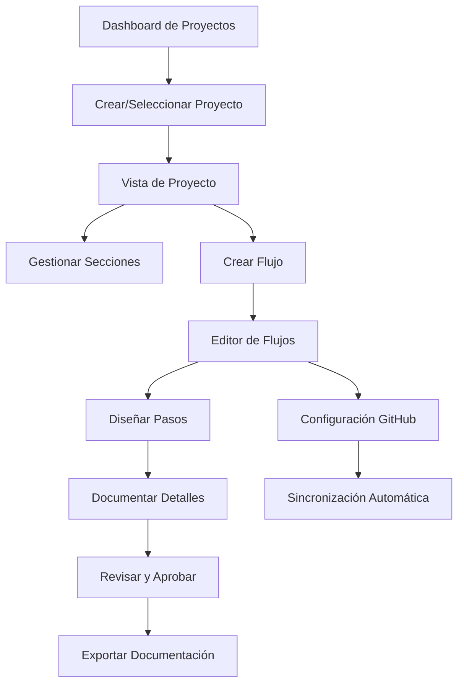

# FlowDocs - Documento de Requerimientos de Producto (PRD)

## 1. Visión General del Producto

FlowDocs es una plataforma moderna de gestión y documentación de flujos de trabajo diseñada específicamente para equipos de desarrollo que trabajan con arquitecturas de microservicios. La aplicación permite crear, gestionar y documentar procesos complejos de manera visual e interactiva, facilitando la comprensión y mantenimiento de sistemas distribuidos.

**Problema a resolver:** Los equipos de desarrollo enfrentan dificultades para documentar y mantener la trazabilidad de flujos complejos entre múltiples microservicios, lo que resulta en pérdida de conocimiento, errores de implementación y dificultades de onboarding.

**Usuarios objetivo:** Equipos de desarrollo, arquitectos de software, product managers y stakeholders técnicos que trabajan con sistemas distribuidos y arquitecturas de microservicios.

**Valor de mercado:** Reducir el tiempo de documentación en un 75%, mejorar la colaboración en equipo en un 90% y acelerar el onboarding de nuevos desarrolladores.

## 2. Funcionalidades Principales

### 2.1 Roles de Usuario

| Rol | Método de Registro | Permisos Principales |
|-----|-------------------|---------------------|
| Desarrollador | Registro por email | Crear y editar flujos, pasos y documentación |
| Arquitecto | Invitación del equipo | Gestión completa de proyectos y arquitectura |
| Stakeholder | Acceso de solo lectura | Visualizar flujos y exportar documentación |

### 2.2 Módulos de Funcionalidad

Nuestra plataforma FlowDocs consta de las siguientes páginas principales:

1. **Página de Inicio**: sección hero con gradientes, navegación principal, estadísticas de impacto.
2. **Dashboard de Proyectos**: lista de proyectos, acciones de creación/edición, filtros y búsqueda.
3. **Vista de Proyecto**: gestión de secciones jerárquicas, lista de flujos, enlaces de documentación.
4. **Editor de Flujos**: diagrama visual interactivo, panel de edición de pasos, gestión de estados.
5. **Configuración**: integración con GitHub, configuración de sincronización, preferencias de usuario.

### 2.3 Detalles de Páginas

| Página | Módulo | Descripción de Funcionalidad |
|--------|--------|------------------------------|
| Página de Inicio | Hero Section | Mostrar valor de la plataforma con gradientes animados, estadísticas de impacto y call-to-action |
| Página de Inicio | Features Grid | Presentar características principales con iconos, cards interactivas y efectos hover |
| Dashboard de Proyectos | Lista de Proyectos | Mostrar proyectos con metadatos, estados, fechas de actualización y acciones rápidas |
| Dashboard de Proyectos | Acciones de Proyecto | Crear, editar, eliminar proyectos con modales responsivos y validación |
| Vista de Proyecto | Árbol de Secciones | Gestionar jerarquía de secciones con drag & drop, edición inline y reordenamiento |
| Vista de Proyecto | Lista de Flujos | Mostrar flujos por sección con filtros por estado, búsqueda y acciones contextuales |
| Vista de Proyecto | Enlaces de Documentación | Gestionar enlaces tipificados (API, Architecture, Requirements) con validación de URLs |
| Editor de Flujos | Diagrama Visual | Crear diagramas interactivos con React Flow, conexiones entre pasos y zoom/pan |
| Editor de Flujos | Panel de Pasos | Editar detalles de pasos: nombre, microservicio, descripción funcional, casos BDD |
| Editor de Flujos | Gestión de Estados | Cambiar estados de flujo (Draft, In Progress, Review, Approved, Completed, Archived) |
| Editor de Flujos | Exportación | Generar PDFs de flujos con metadatos, imprimir diagramas optimizados |
| Configuración | Integración GitHub | Configurar tokens, repositorios, sincronización automática de cambios |

## 3. Procesos Principales

### Flujo Principal de Usuario

1. **Creación de Proyecto**: El usuario accede al dashboard, crea un nuevo proyecto con nombre, descripción y enlaces de documentación
2. **Organización por Secciones**: Define una estructura jerárquica de secciones para organizar los flujos
3. **Creación de Flujos**: Dentro de cada sección, crea flujos con estados específicos
4. **Diseño Visual**: Utiliza el editor visual para crear diagramas de pasos interconectados
5. **Documentación Detallada**: Completa cada paso con información técnica, casos BDD y enlaces relacionados
6. **Colaboración**: Comparte el proyecto con el equipo para revisión y feedback
7. **Exportación**: Genera documentación en PDF para stakeholders externos

## 4. Diseño de Interfaz de Usuario

### 4.1 Estilo de Diseño

- **Colores primarios**: Gradiente púrpura a rosa (#9333ea a #ec4899)
- **Colores secundarios**: Naranja (#f97316) y azul (#3b82f6)
- **Estilo de botones**: Redondeados con gradientes y efectos hover/shadow
- **Tipografía**: Inter/System fonts, tamaños 14px-72px según jerarquía
- **Estilo de layout**: Cards con sombras, navegación superior, paneles laterales
- **Iconografía**: Lucide React con estilo outline, tamaño consistente 16-24px

### 4.2 Resumen de Diseño por Página

| Página | Módulo | Elementos de UI |
|--------|--------|----------------|
| Página de Inicio | Hero Section | Gradiente de fondo púrpura-rosa-naranja, tipografía grande con text-clip, badges con efectos sparkle |
| Dashboard | Lista de Proyectos | Cards con hover effects, badges de estado con colores semánticos, botones de acción con iconos |
| Editor de Flujos | Diagrama Visual | Canvas de React Flow con controles de zoom, nodos personalizados con gradientes, conexiones suaves |
| Panel de Pasos | Formulario de Edición | Inputs con focus states, textareas expandibles, tabs para organizar información |
| Configuración | GitHub Integration | Toggle switches, input fields con validación, status indicators con colores |

### 4.3 Responsividad

La aplicación está diseñada con enfoque mobile-first, adaptándose desde 320px hasta pantallas 4K. Incluye optimización táctil para tablets y navegación simplificada en móviles con menús colapsables.